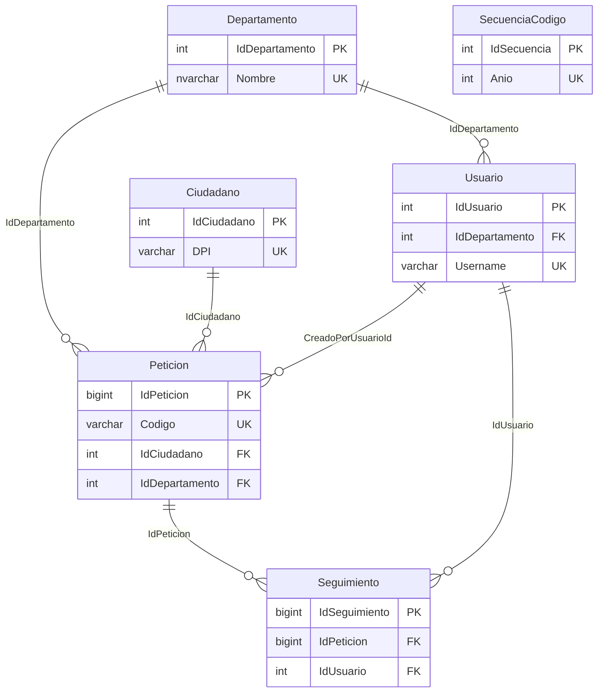

================================================================================
  SISTEMA DE PETICIONES CIUDADANAS - MUNICIPALIDAD DE JALAPA
  DOCUMENTACION DE BASE DE DATOS
================================================================================

Script de referencia analizado:
  bdmUNI_importar_SSMS.sql  (fecha en script: 14/06/2026)

Motor:
  Microsoft SQL Server (compatibilidad 160 — SQL Server 2022)

Nombre de la base de datos:
  MuniPeticionesJalapa

Esquema:
  dbo

Objetos adicionales:
  No incluye vistas, procedimientos almacenados, funciones ni triggers.
  Solo tablas, indices, restricciones (PK, FK, UNIQUE, CHECK) y valores DEFAULT.

================================================================================
  1. RESUMEN DE LA BASE DE DATOS
================================================================================

MuniPeticionesJalapa es la base de datos del sistema de registro y seguimiento
de peticiones ciudadanas de la Municipalidad de Jalapa. Centraliza:

  - Ciudadanos que presentan peticiones (identificados por DPI).
  - Departamentos municipales que reciben y gestionan las peticiones.
  - Usuarios del sistema con roles (ADMIN, ALCALDE, JEFE_DEPTO, RECEPCION).
  - Peticiones con codigo unico, estado, prioridad y fechas de control.
  - Historial de seguimiento (cambios de estado por peticion).
  - Secuencia anual para generacion de codigos de peticion.

Tablas (6):
  Ciudadano, Departamento, Usuario, Peticion, Seguimiento, SecuenciaCodigo

================================================================================
  2. TABLAS PRINCIPALES Y SU FUNCION
================================================================================

------------------------------------------------------------------------------
Ciudadano
------------------------------------------------------------------------------
  Registra a las personas que presentan peticiones. El DPI es unico y debe
  tener exactamente 13 digitos numericos.

------------------------------------------------------------------------------
Departamento
------------------------------------------------------------------------------
  Catalogo de areas municipales (Despacho Alcaldia, Atencion Ciudadana,
  Obras Municipales, etc.). Cada nombre es unico.

------------------------------------------------------------------------------
Usuario
------------------------------------------------------------------------------
  Cuentas de acceso al sistema. Pueden estar asociadas opcionalmente a un
  departamento. Los roles permitidos estan restringidos por CHECK constraint.
  Solo puede existir un ALCALDE activo a la vez (indice filtrado unico).

------------------------------------------------------------------------------
Peticion
------------------------------------------------------------------------------
  Solicitud ciudadana asignada a un departamento. Tiene codigo unico,
  titulo, descripcion, estado, prioridad y fechas de creacion, limite y cierre.
  Referencia al ciudadano, departamento y usuario creador.

------------------------------------------------------------------------------
Seguimiento
------------------------------------------------------------------------------
  Bitacora de cambios de estado de cada peticion. Al eliminar una peticion,
  sus registros de seguimiento se eliminan en cascada (ON DELETE CASCADE).

------------------------------------------------------------------------------
SecuenciaCodigo
------------------------------------------------------------------------------
  Control del correlativo anual para codigos de peticion. Un registro por anio
  (Anio unico). Prefijo por defecto: PET.

================================================================================
  3. RELACIONES ENTRE TABLAS
================================================================================

Diagrama logico:

  Departamento (1) ----< (N) Usuario
       |
       +----< (N) Peticion >---- (N) Ciudadano (1)
       |              |
       |              +---- (N) Seguimiento >---- (0..1) Usuario
       |
  Peticion.CreadoPorUsuarioId ----> Usuario (opcional)

Llaves foraneas definidas en el script:

  Tabla          | Columna              | Referencia                    | Accion
  ---------------|----------------------|-------------------------------|--------
  Peticion       | IdCiudadano          | Ciudadano.IdCiudadano         | —
  Peticion       | IdDepartamento       | Departamento.IdDepartamento   | —
  Peticion       | CreadoPorUsuarioId   | Usuario.IdUsuario             | —
  Seguimiento    | IdPeticion           | Peticion.IdPeticion           | CASCADE
  Seguimiento    | IdUsuario            | Usuario.IdUsuario             | —
  Usuario        | IdDepartamento       | Departamento.IdDepartamento   | —

Diagrama (Mermaid):

================================================================================
  4. CAMPOS IMPORTANTES POR TABLA
================================================================================

------------------------------------------------------------------------------
Ciudadano
------------------------------------------------------------------------------
  Campo           | Tipo              | Restricciones / Notas
  ----------------|-------------------|------------------------------------------
  IdCiudadano     | int IDENTITY      | PK
  DPI             | varchar(13)       | NOT NULL, UNIQUE (UQ_Ciudadano_DPI)
  Nombres         | nvarchar(120)     | NOT NULL, no vacio (CHECK)
  Apellidos       | nvarchar(120)     | NOT NULL, no vacio (CHECK)
  Telefono        | varchar(20)       | NULL; 8-20 chars, solo digitos y +
  Correo          | nvarchar(150)     | NULL; UNIQUE si no es NULL
  Direccion       | nvarchar(250)     | NULL
  Activo          | bit               | NOT NULL, DEFAULT 1
  FechaRegistro   | datetime2(0)      | NOT NULL, DEFAULT sysdatetime()

------------------------------------------------------------------------------
Departamento
------------------------------------------------------------------------------
  Campo             | Tipo              | Restricciones / Notas
  ------------------|-------------------|------------------------------------------
  IdDepartamento    | int IDENTITY      | PK
  Nombre            | nvarchar(100)     | NOT NULL, UNIQUE (UQ_Departamento_Nombre)
  Activo            | bit               | NOT NULL, DEFAULT 1
  FechaCreacion     | datetime2(0)      | NOT NULL, DEFAULT sysdatetime()

------------------------------------------------------------------------------
Usuario
------------------------------------------------------------------------------
  Campo               | Tipo              | Restricciones / Notas
  --------------------|-------------------|------------------------------------------
  IdUsuario           | int IDENTITY      | PK
  IdDepartamento      | int               | NULL, FK -> Departamento
  Username            | varchar(50)       | NOT NULL, UNIQUE, minimo 4 caracteres
  PasswordHash        | nvarchar(255)     | NOT NULL (hash bcrypt en datos iniciales)
  NombreCompleto      | nvarchar(150)     | NOT NULL, no vacio (CHECK)
  Rol                 | varchar(20)       | NOT NULL; ADMIN | ALCALDE | JEFE_DEPTO | RECEPCION
  Activo              | bit               | NOT NULL, DEFAULT 1
  FechaCreacion       | datetime2(0)      | NOT NULL, DEFAULT sysdatetime()
  FechaUltimoAcceso   | datetime2(0)      | NULL

  Indice especial: UX_Usuario_UnicoAlcaldeActivo — solo un ALCALDE activo.

------------------------------------------------------------------------------
Peticion
------------------------------------------------------------------------------
  Campo               | Tipo              | Restricciones / Notas
  --------------------|-------------------|------------------------------------------
  IdPeticion          | bigint IDENTITY   | PK
  Codigo              | varchar(25)       | NOT NULL, UNIQUE (UQ_Peticion_Codigo)
  IdCiudadano         | int               | NOT NULL, FK -> Ciudadano
  IdDepartamento      | int               | NOT NULL, FK -> Departamento
  CreadoPorUsuarioId  | int               | NULL, FK -> Usuario
  Titulo              | nvarchar(200)     | NOT NULL, no vacio (CHECK)
  Descripcion         | nvarchar(max)     | NOT NULL, no vacia (CHECK)
  Estado              | varchar(20)       | NOT NULL, DEFAULT 'RECIBIDA'
  Prioridad           | varchar(10)       | NOT NULL, DEFAULT 'MEDIA'
  FechaCreacion       | datetime2(0)      | NOT NULL, DEFAULT sysdatetime()
  FechaLimite         | datetime2(0)      | NULL
  FechaCierre         | datetime2(0)      | NULL; debe ser >= FechaCreacion si existe

  Estados validos (CHECK):
    RECIBIDA, EN_REVISION, ASIGNADA, EN_PROCESO, RESUELTA, RECHAZADA, CERRADA

  Prioridades validas (CHECK):
    BAJA, MEDIA, ALTA

  Indices de consulta:
    IX_Peticion_Ciudadano, IX_Peticion_Departamento, IX_Peticion_Estado_Fecha

------------------------------------------------------------------------------
Seguimiento
------------------------------------------------------------------------------
  Campo             | Tipo              | Restricciones / Notas
  ------------------|-------------------|------------------------------------------
  IdSeguimiento     | bigint IDENTITY   | PK
  IdPeticion        | bigint            | NOT NULL, FK -> Peticion (CASCADE)
  IdUsuario         | int               | NULL, FK -> Usuario
  EstadoAnterior    | varchar(20)       | NULL; mismos valores que Estado peticion
  EstadoNuevo       | varchar(20)       | NOT NULL; mismos valores que Estado peticion
  Comentario        | nvarchar(500)     | NULL
  FechaMovimiento   | datetime2(0)      | NOT NULL, DEFAULT sysdatetime()

  Indice: IX_Seguimiento_Peticion_Fecha (IdPeticion, FechaMovimiento DESC)

------------------------------------------------------------------------------
SecuenciaCodigo
------------------------------------------------------------------------------
  Campo                 | Tipo              | Restricciones / Notas
  ----------------------|-------------------|------------------------------------------
  IdSecuencia           | int IDENTITY      | PK
  Anio                  | int               | NOT NULL, UNIQUE; rango 2000-2100
  Prefijo               | varchar(10)       | NOT NULL, DEFAULT 'PET'
  CorrelativoActual     | int               | NOT NULL, DEFAULT 0; >= 0
  FechaActualizacion    | datetime2(0)      | NOT NULL, DEFAULT sysdatetime()

================================================================================
  5. DATOS INICIALES CARGADOS
================================================================================

El script inserta datos de prueba con SET IDENTITY_INSERT. Resumen:

------------------------------------------------------------------------------
Departamentos (5 registros)
------------------------------------------------------------------------------
  Id | Nombre
  ---|------------------
  1  | DESPACHO ALCALDÍA
  2  | ATENCIÓN CIUDADANA
  3  | OBRAS MUNICIPALES
  4  | JALAPAGUA
  5  | EMPRESA ELECTRICA

------------------------------------------------------------------------------
Usuarios (6 registros activos)
------------------------------------------------------------------------------
  Id   | Username        | Rol        | Departamento | Nombre completo
  -----|-----------------|------------|--------------|---------------------------
  1    | admin           | ADMIN      | (ninguno)    | ADMINISTRADOR GENERAL
  2    | alcalde         | ALCALDE    | 1            | ALCALDE MUNICIPAL
  1003 | recepcion       | RECEPCION  | (ninguno)    | Recepcionista
  *    | jefe_obras      | JEFE_DEPTO | 3            | Jefe - OBRAS MUNICIPALES
  *    | jefe_jalapagua  | JEFE_DEPTO | 4            | Jefe - JALAPAGUA
  *    | jefe_electrica  | JEFE_DEPTO | 5            | Jefe - EMPRESA ELECTRICA

  Las contrasenas estan almacenadas como hash bcrypt.
  Credenciales de prueba (ver tambien POSTMAN_GUIA.txt):
    admin / admin123, alcalde / alcalde123, recepcion / recepcion123
    jefes de departamento / jefe123 (jefe_obras, jefe_jalapagua, jefe_electrica)

  Nota: no hay JEFE_DEPTO para DESPACHO ALCALDIA ni ATENCION CIUDADANA;
  esos roles los cubren alcalde y recepcion.

  Para (re)cargar los jefes de forma idempotente:
    cd backend-muni && npm run seed:jefes

------------------------------------------------------------------------------
Ciudadanos (6 registros)
------------------------------------------------------------------------------
  Id   | DPI             | Nombres | Apellidos
  -----|-----------------|---------|----------
  1    | 1234567890123   | Juan    | Perez
  2    | 9876543210987   | Maria   | Lopez
  1002 | 1234567890101   | Juan    | Perez
  1003 | 0908678909231   | Juan    | Molina
  1005 | 2145639874152   | Javier  | Estrada
  1008 | 2547896532125   | Pedro   | Perez

------------------------------------------------------------------------------
Peticiones (3 registros)
------------------------------------------------------------------------------
  Id     | Codigo           | Ciudadano | Depto | Estado      | Prioridad | Titulo
  -------|------------------|-----------|-------|-------------|-----------|---------------------------
  2      | JAL-2026-000002  | 2         | 3     | EN_PROCESO  | MEDIA     | Alumbrado publico deficiente
  10004  | JAL-2026-000008  | 1005      | 2     | RECIBIDA    | MEDIA     | Apoyo con Material de Trabajo
  10005  | JAL-2026-000009  | 1008      | 2     | RECIBIDA    | BAJA      | Prueba

------------------------------------------------------------------------------
Seguimiento (4 registros)
------------------------------------------------------------------------------
  Historial de creacion y cambio de estado de las peticiones anteriores
  (incluye movimiento de la peticion 2 de RESUELTA a EN_PROCESO).

------------------------------------------------------------------------------
SecuenciaCodigo (1 registro)
------------------------------------------------------------------------------
  Anio: 2026 | Prefijo: PET | CorrelativoActual: 9

================================================================================
  6. IMPORTAR LA BASE DE DATOS EN SQL SERVER MANAGEMENT STUDIO
     (SQL Server Express)
================================================================================

Requisitos:
  - SQL Server Express instalado y en ejecucion.
  - SQL Server Management Studio (SSMS).
  - Archivo: bdmUNI_importar_SSMS.sql

IMPORTANTE:
  El script elimina la base MuniPeticionesJalapa si ya existe
  (DROP DATABASE con SINGLE_USER). Hacer respaldo antes si hay datos
  que desee conservar.

Pasos:

  1. Abrir SSMS y conectarse a la instancia local:
       Servidor: localhost\SQLEXPRESS
       Autenticacion: Windows Authentication

  2. Menu Archivo -> Abrir -> Archivo...
     Seleccionar bdmUNI_importar_SSMS.sql

  3. Verificar que la barra de herramientas apunte a la instancia correcta
     (no es necesario seleccionar una base de datos previa; el script crea
     MuniPeticionesJalapa desde master).

  4. Ejecutar el script completo (F5 o boton Ejecutar).
     Debe completarse sin errores y crear tablas, indices, restricciones
     e inserts iniciales.

  5. Confirmar en el Explorador de objetos:
       Bases de datos -> MuniPeticionesJalapa -> Tablas
     Deben aparecer las 6 tablas dbo.

  6. Permisos para el backend (Windows Authentication):
     El backend usa Trusted Connection con la cuenta de Windows que ejecuta
     Node.js. Asegurese de que ese usuario tenga permisos de lectura/escritura
     sobre MuniPeticionesJalapa (roles db_datareader y db_datawriter en SSMS,
     o permisos equivalentes).

================================================================================
  7. CONEXION Y CONFIGURACION DEL PROYECTO
================================================================================

El backend (backend-muni) se conecta mediante mssql con el driver msnodesqlv8
(autenticacion Windows) y la configuracion en backend-muni/src/config/db.js.

Cadena de conexion configurada por defecto:

  Server=localhost\SQLEXPRESS;Database=MuniPeticionesJalapa;Trusted_Connection=True;TrustServerCertificate=True;

Variables de entorno opcionales (archivo backend-muni/.env):

  DB_SERVER=localhost\SQLEXPRESS
  DB_DATABASE=MuniPeticionesJalapa
  DB_TRUSTED_CONNECTION=true
  DB_CONNECTION_STRING=Server=localhost\\SQLEXPRESS;Database=MuniPeticionesJalapa;Trusted_Connection=True;TrustServerCertificate=True;

Valores por defecto si no hay .env (backend-muni/src/config/db.js):

  server:              localhost\SQLEXPRESS
  database:            MuniPeticionesJalapa
  driver:              msnodesqlv8
  trustedConnection:   true
  trustServerCertificate: true

Ejemplo de archivo .env:

  PORT=5000
  NODE_ENV=development
  DB_SERVER=localhost\\SQLEXPRESS
  DB_DATABASE=MuniPeticionesJalapa
  JWT_SECRET=su_clave_secreta_jwt
  JWT_EXPIRES_IN=8h

Verificar conexion despues de importar la BD y configurar .env:

  1. cd backend-muni
  2. npm install
  3. npm start
  4. GET http://localhost:5000/db/ping

Respuesta esperada si la conexion es correcta: confirmacion de ping a la
base de datos (ver POSTMAN_GUIA.txt, seccion "Ping base de datos").

================================================================================
  REFERENCIAS EN EL PROYECTO
================================================================================

  POSTMAN_GUIA.txt     — Pruebas API, usuarios de prueba y valores validos
  backend-muni/src/config/db.js — Configuracion de conexion SQL Server
  backend-muni/src/db/pool.js     — Pool de conexiones (mssql/msnodesqlv8)

================================================================================
